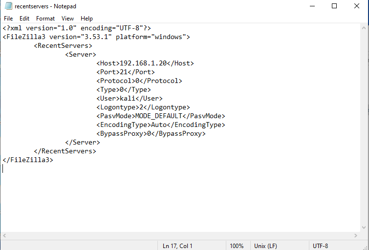
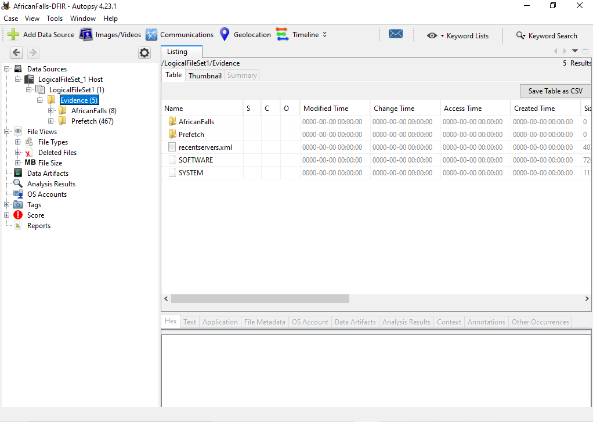
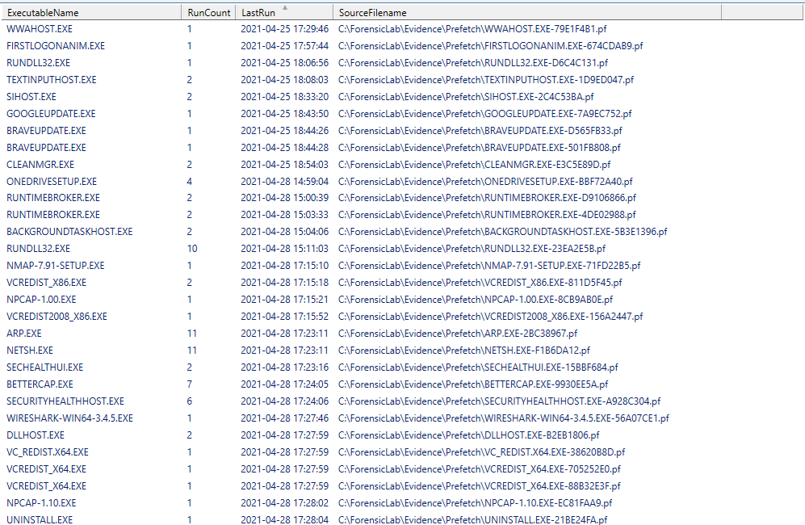

# Windows Endpoint Forensics: AfricanFalls Case

I investigated a forensic image (`.ad1`) of a Windows workstation from the **AfricanFalls** DFIR challenge. The question was simple: what did the user of this machine do, and did they try to hide it? The answer: they installed hacking tools, scanned and sniffed the network, set up an FTP connection to a Kali machine, and then wiped files with SDelete.

**Tools:** FTK Imager, Autopsy, PECmd (Prefetch), Registry Explorer.

---

## What I was looking for

1. **Tools that shouldn't be there**: scanners, sniffers or pentest tools run from user folders.
2. **Anti-forensics**: secure deletion before the image was taken.
3. **Exfiltration**: data sent out over FTP or another plain protocol.

(Full hypotheses and steps: [`playbooks/threat_hunting_hypothesis.md`](playbooks/threat_hunting_hypothesis.md))

---

## 1. What ran on the machine (Prefetch)

Windows keeps a Prefetch file for each program it runs, including how many times it ran and when. I parsed them with **PECmd**:

| Program | Times run | Last run (UTC) | What it's for |
| :--- | :---: | :--- | :--- |
| `BETTERCAP.EXE` | 7 | 2021-04-28 17:24:05 | Man-in-the-middle / sniffing |
| `NMAP.EXE` | 3 | 2021-04-28 17:37:54 | Port scanning |
| `WIRESHARK.EXE` / `DUMPCAP.EXE` | 1 / 8 | 2021-04-28 17:39:31 | Packet capture |
| `IPSCAN.EXE` | 3 | 2021-04-29 16:28:12 | IP range scanning |
| `TORBROWSER-INSTALL...EXE` | 1 | 2021-04-29 18:22:32 | Anonymous browsing (Tor) |
| `QUICKCRYPTO.EXE` | 5 | 2021-04-30 00:28:40 | File encryption |
| `BURPSUITECOMMUNITY.EXE` | 1 | 2021-04-30 00:40:45 | Web proxy / testing |
| `SDELETE.EXE` / `SDELETE64.EXE` | 4 / 1 | 2021-04-30 01:08:06 | Secure file deletion |

Any one of these could have a legitimate reason on an IT admin's machine. All of them together, ending with SDelete, is not normal.

---

## 2. Registry (persistence check)

In the `SOFTWARE` hive (`Microsoft\Windows\CurrentVersion\Run`) there was **no active auto-start entry**, so I found no persistence. There was one **deleted** value, `LastServiceStart`, last modified **2021-04-30 00:58:47 UTC**, about 10 minutes before SDelete last ran. I can't say what it was, but the timing fits with the cleanup.

---

## 3. FTP connection to a Kali machine

FileZilla's `recentservers.xml` had a saved connection:

| Field | Value |
| :--- | :--- |
| Host | `192.168.1.20` |
| Port | `21` (FTP, unencrypted) |
| Username | `kali` |

A saved FTP login to a host with the username `kali` (the default user on Kali Linux) points to a transfer to an attacker-controlled machine on the same network.

---

## 4. Timeline (Autopsy)

| Date | Activity |
| :--- | :--- |
| 2021-04-28 | Installs capture drivers (WinPcap/Npcap), runs Nmap and Bettercap |
| 2021-04-29 | Scans the IP range, installs Tor Browser |
| 2021-04-30 | Encrypts files with QuickCrypto, prepares the FTP transfer to `192.168.1.20`, runs SDelete at **01:08:06 UTC**, then the system is shut down and imaged |

---

## MITRE ATT&CK

| Technique | ID | Evidence |
| :--- | :--- | :--- |
| Network Service Discovery | `T1046` | Nmap, IPScan |
| Network Sniffing | `T1040` | Bettercap, Wireshark |
| Indicator Removal: File Deletion | `T1070.004` | SDelete |
| Proxy: Multi-hop Proxy (Tor) | `T1090.003` | Tor Browser install |
| Exfiltration Over Unencrypted Non-C2 Protocol | `T1048.003` | FTP to `192.168.1.20:21` |

---

## IOCs

- Staging host: `192.168.1.20` (FTP, TCP/21, username `kali`)
- Tools: `bettercap.exe`, `nmap.exe`, `ipscan.exe`, `quickcrypto.exe`, `sdelete.exe`, `sdelete64.exe`

## Response

1. Isolate the workstation and block traffic to/from `192.168.1.20`.
2. Reset any credentials used on the machine (including the FTP account).
3. Re-image the machine: because SDelete was used, I can't be sure what was removed, so cleaning it isn't enough.

---

## Other files in this repo

| File | What it is |
| :--- | :--- |
| [`playbooks/incident_response_runbook.md`](playbooks/incident_response_runbook.md) | Response steps for this type of incident |
| [`queries_and_scripts/detection_rules.sigma.yml`](queries_and_scripts/detection_rules.sigma.yml) | Sigma rule to detect SDelete execution |
| [`queries_and_scripts/hunt_temp_execution.ps1`](queries_and_scripts/hunt_temp_execution.ps1) | Filters PECmd output for the suspicious tools above |
| [`queries_and_scripts/artifact_extraction.bat`](queries_and_scripts/artifact_extraction.bat) | Collects Prefetch, registry hives, event logs and network state from a live host |

**Author:** Alejandro José Vargas
